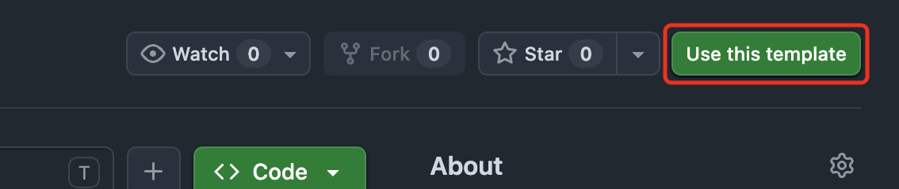
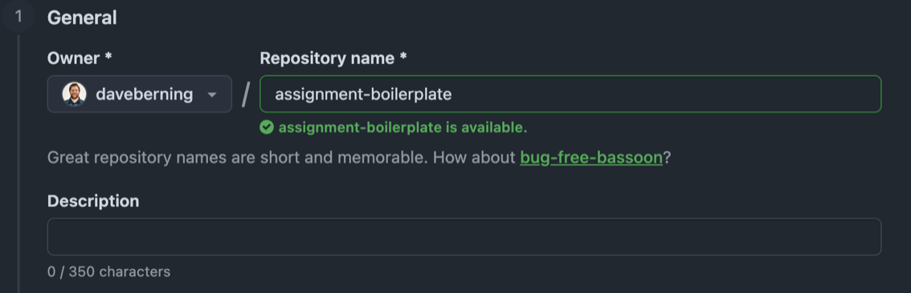
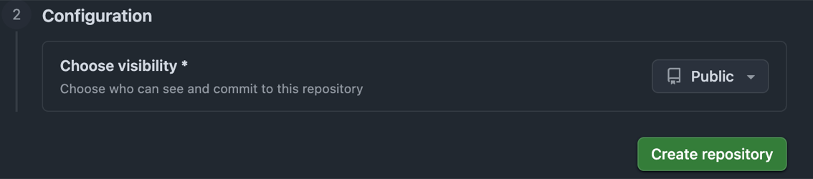
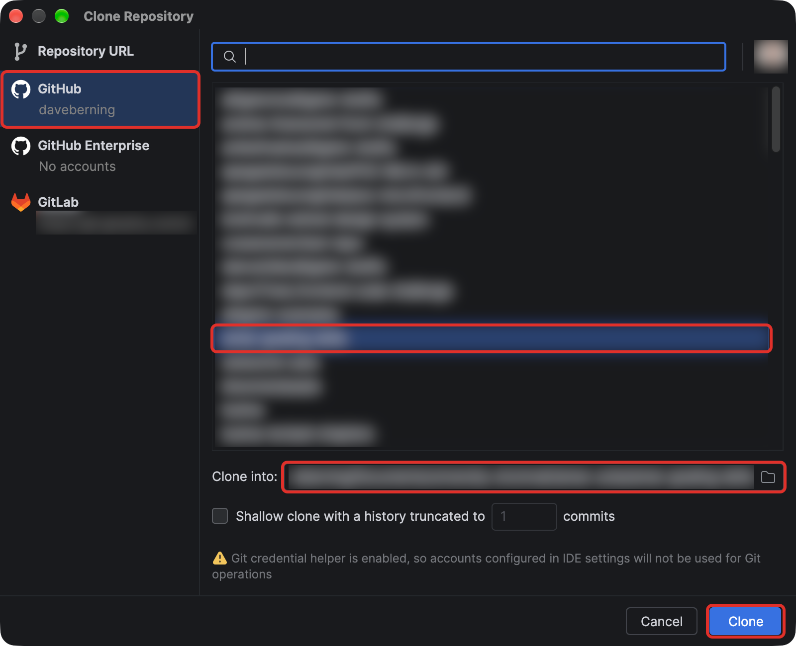
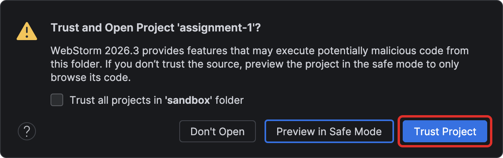
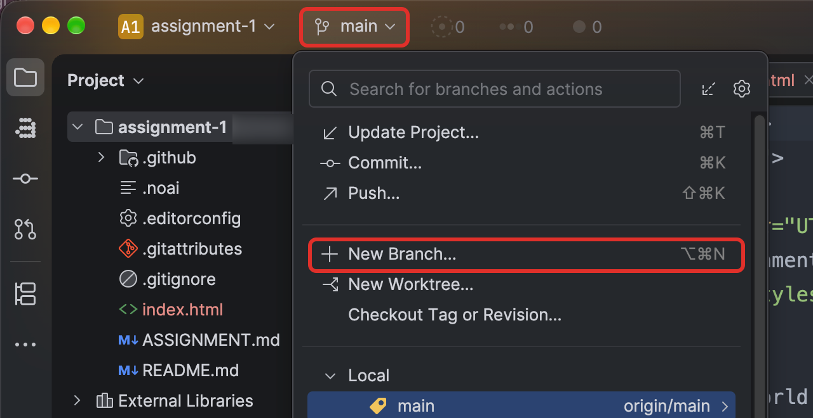
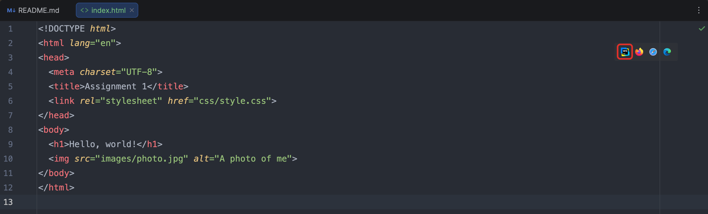

# 🏁 Getting Started

[← Back to the README](../README.md)

Do these steps once at the start of every assignment.

> [!TIP]
> **First assignment?** Do the [one-time WebStorm setup](WEBSTORM_SETUP.md) first.

## 1. Create your own repo from this template

- At the top of this repo on GitHub, click the green **Use this template** button. (If a
  menu opens, choose **Create a new repository**.)

  

- Set **Owner** to your GitHub account.
- Give it a **Repository name** — use `vent-haven`.

  

- Set visibility to **Public** (GitHub Pages needs a public repo on a free account).

  

- Click **Create repository**. GitHub takes you to your new repo.

## 2. Clone your new repo in WebStorm

- On the WebStorm welcome screen, click **Clone Repository**. (If a project is already
  open, use **File** → **New** → **Project from Version Control…**)
- Click **GitHub** on the left. Pick `<your-username>/<repo-name>` from the list, not
  this template.
- Check the **Directory** it will save to, then click **Clone**.

  

- If WebStorm asks whether to trust the project, click **Trust Project**.

  

## 3. Create your `develop` branch

- Click the branch name (`main`) at the top left of the window, then **New Branch…**

  

- Name it `develop`, leave **Checkout branch** checked, and click **Create**.

  <!-- SCREENSHOT: webstorm-new-branch.png — Create New Branch dialog with the name develop, Checkout branch checked, and Create highlighted -->

- The top left should now say `develop`. **Check this before your first commit.** Work
  committed to `main` can't go in your pull request.

## 4. Preview your page while you work

Open `index.html` and hover over the top right of the editor. Click the WebStorm icon for
the built-in preview, or a browser icon to open it in that browser. The page reloads every
time you save.

---

**Next:** [Publishing to GitHub Pages →](PUBLISHING.md)
