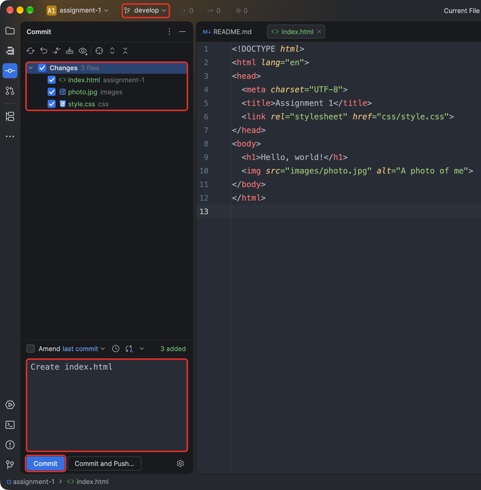
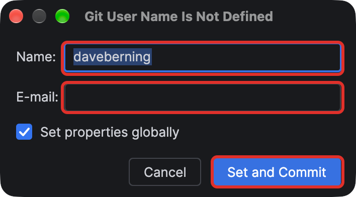
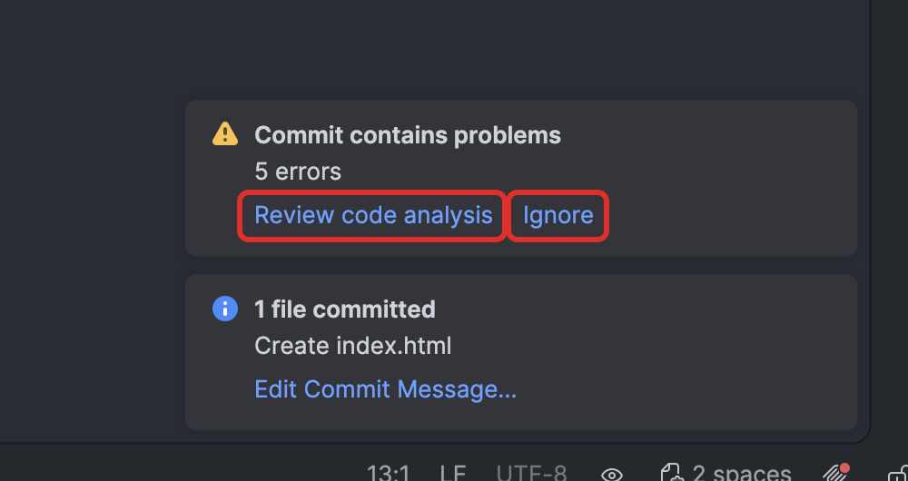
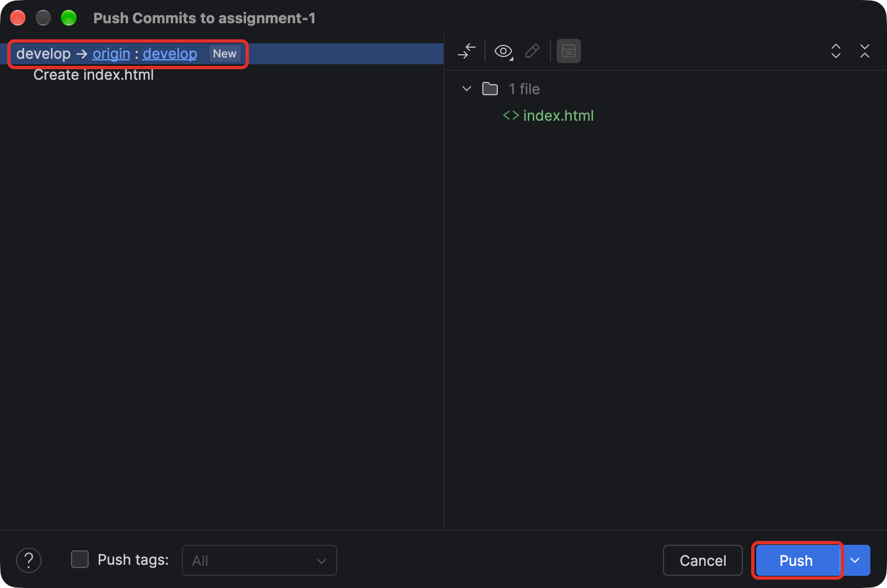
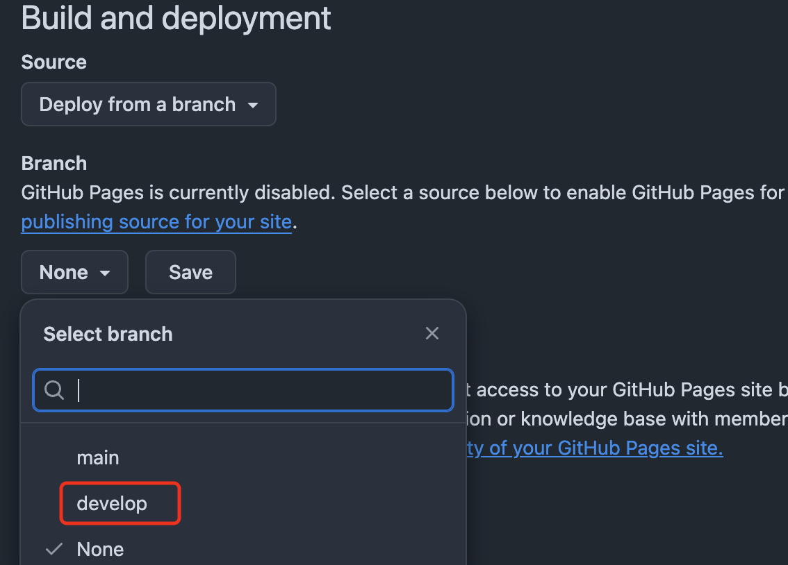
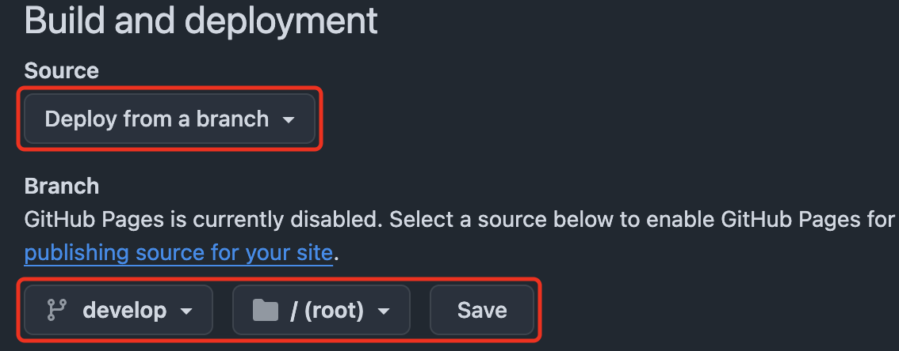
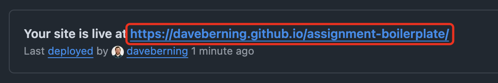

# 🚀 Publishing to GitHub Pages

[← Back to the README](../README.md)

Your work has to be live on the web before you can submit it. Commit and push as you
work, then turn on GitHub Pages once.

## 1. Commit your work in WebStorm

- Make sure the branch name at the top left says `develop`.
- Press <kbd>Cmd</kbd> + <kbd>K</kbd> to open the **Commit** panel. Check the files you
  want to include.
- Type a short message describing the change, like `Create index.html`, and click **Commit**.

  

- **First commit only:** WebStorm asks for your **Name** and **Email**. Use your **UC email** (the one on your
  GitHub account) so your commits show up as yours. Leave **Set properties globally** checked and click **Set and
  Commit**. It won't ask again.

  

- **If WebStorm says it found problems:** before each commit, WebStorm checks your code.
  If it finds errors or warnings, it stops and asks what to do.
    - Click **Review** to see the list. Double-click a problem to jump to it. Common ones
      are a misspelled image path, a missing `alt`, or a typo in a CSS property.
    - Fix what you can, then commit again.
    - If you've checked and want to commit anyway (for example, to save work in
      progress), click **Commit Anyway**. Your commit still goes through.

  

- Commit often: every time you finish a piece of the page, not once at the end.

## 2. Push your work to GitHub

- Press <kbd>Cmd</kbd> + <kbd>Shift</kbd> + <kbd>K</kbd>. The **Push** dialog shows
  `develop → origin : develop` and the commits that will be sent.
- Click **Push**. The first push creates your `develop` branch on GitHub.

  

- Push after every commit (or click **Commit and Push** in the Commit panel to do both
  at once).

## 3. Turn on GitHub Pages

- On GitHub, open **your** repo (the one you created from the template) and go to **Settings** → **Pages**.
- Under **Branch**, click the **None** dropdown and pick `develop`.

  

- Make sure **Source** is *Deploy from a branch* and the folder is `/ (root)`, then click **Save**.

  

## 4. Open your live site

The first deploy takes a minute or two. Reload the Pages settings screen until it says
**Your site is live at**, then click the URL:

```
https://<your-username>.github.io/<repo-name>/
```



Confirm the page loads correctly — the right content, no missing images, no broken styles.

## 🛠️ Troubleshooting

- **404 page:** make sure an `index.html` exists in the root of the branch you selected, and that the filename is
  lowercase.
- **Old version showing:** Pages caches aggressively. Wait a minute, then hard refresh
  (<kbd>Cmd</kbd>/<kbd>Ctrl</kbd> + <kbd>Shift</kbd> + <kbd>R</kbd>).
- **Nothing deployed:** check the **Actions** tab for a failed `pages build and deployment` run.

---

**Next:** [Submitting the Assignment →](SUBMITTING.md)
