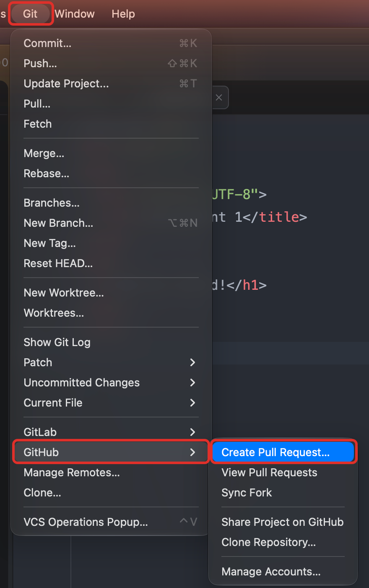
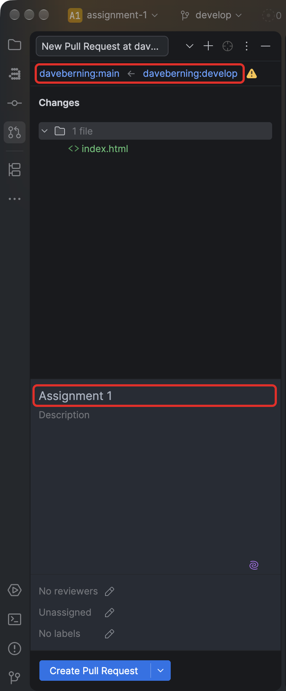
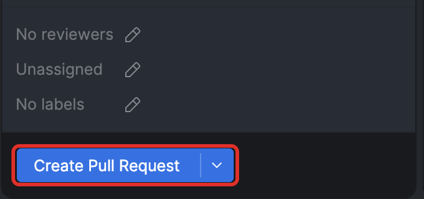
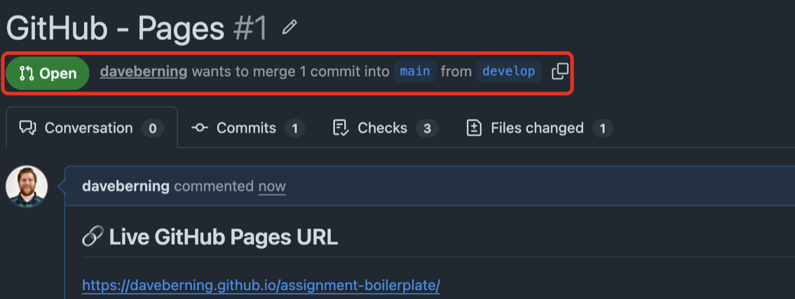
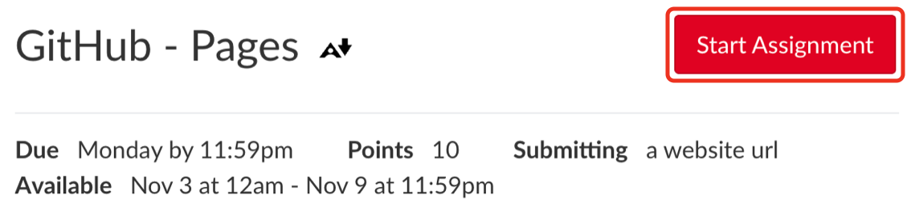
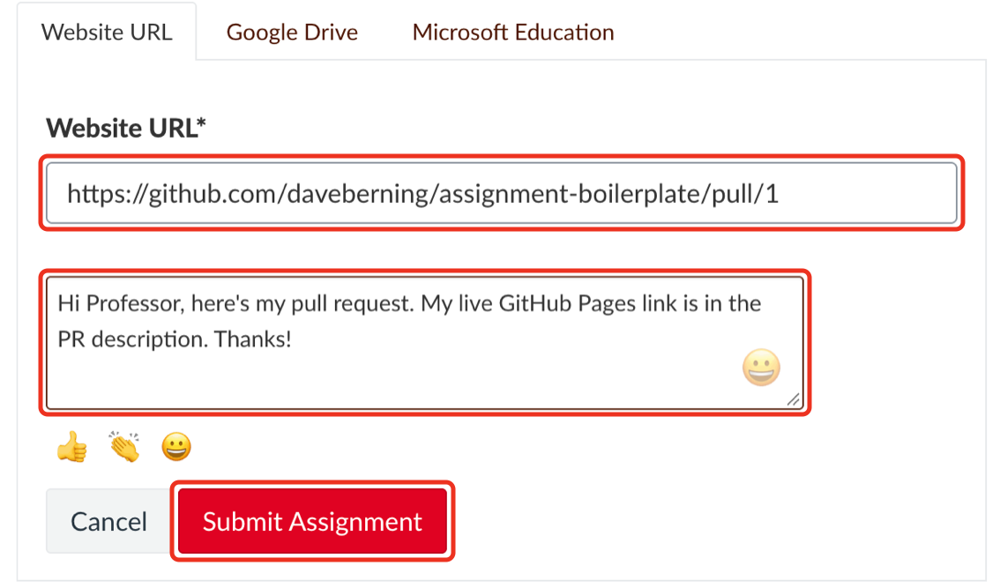

# 📬 Submitting the Assignment

[← Back to the README](../README.md)

Submission has two parts: publish the site, then submit a pull request URL in Canvas.

## 1. Publish to GitHub Pages

Follow [Publishing to GitHub Pages](PUBLISHING.md) first.

## 2. Open a pull request into `main`

- Push your final commits first (<kbd>Cmd</kbd> + <kbd>Shift</kbd> + <kbd>K</kbd>).
- In WebStorm, open the **Git** menu → **GitHub** → **Create Pull Request…** The **Pull Requests** panel opens with
  a new pull request form.

  

- At the top of the form, confirm it says `main` ← `develop`. If not, click each branch
  name to change it. Title the pull request with the assignment name.

  

- The description is pre-filled with a template. Fill in every section: paste your live
  GitHub Pages URL under **Live GitHub Pages URL**, write a short **Summary**, check off
  the **Checklist** by changing each `[ ]` to `[x]`, and answer the **Reflection**. **Notes for your instructor** is
  optional. Leave the `<!-- -->` hint lines as they are; they're hidden once the pull request is created.
    - If the description is empty, open `.github/pull_request_template.md` in WebStorm,
      copy everything in it, and paste it into the description.

  <!-- SCREENSHOT: webstorm-pr-description.png — Description field filled in from the template, with the GitHub Pages URL highlighted -->

- Click **Create Pull Request**. Don't use the dropdown's **Create Draft Pull Request**.

  

- The new pull request opens in the panel. Click **Open on GitHub** (the link at the
  top of the pull request) to see it in your browser. It should say **Open** and show it
  merging `develop` into `main`. Don't merge it.

  

## 3. Submit the pull request URL in Canvas

- Copy the pull request URL from your browser's address bar. It looks like
  `https://github.com/<your-username>/<repo-name>/pull/1`.
- Open the matching assignment in Canvas and click the red **Start Assignment** button.
  The page scrolls down to the submission form.

  

- On the **Website URL** tab, paste your **pull request URL** into the **Website URL**
  field. Don't paste your GitHub Pages URL here; that goes in the pull request.
- Optional: add a note for your instructor in **Comments**.
- Click the red **Submit Assignment** button.

  

> [!CAUTION]
> Late or missing submissions are graded on what is in the pull request at the deadline, so push your final commits
> before you submit.
