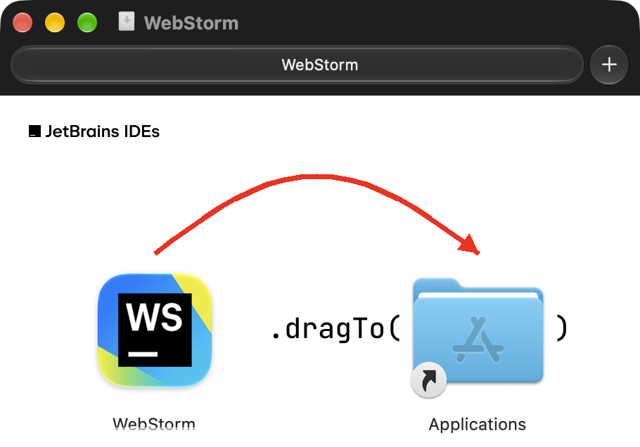
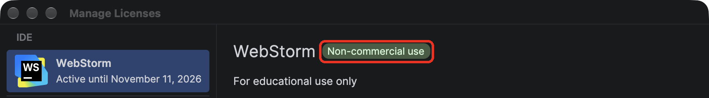
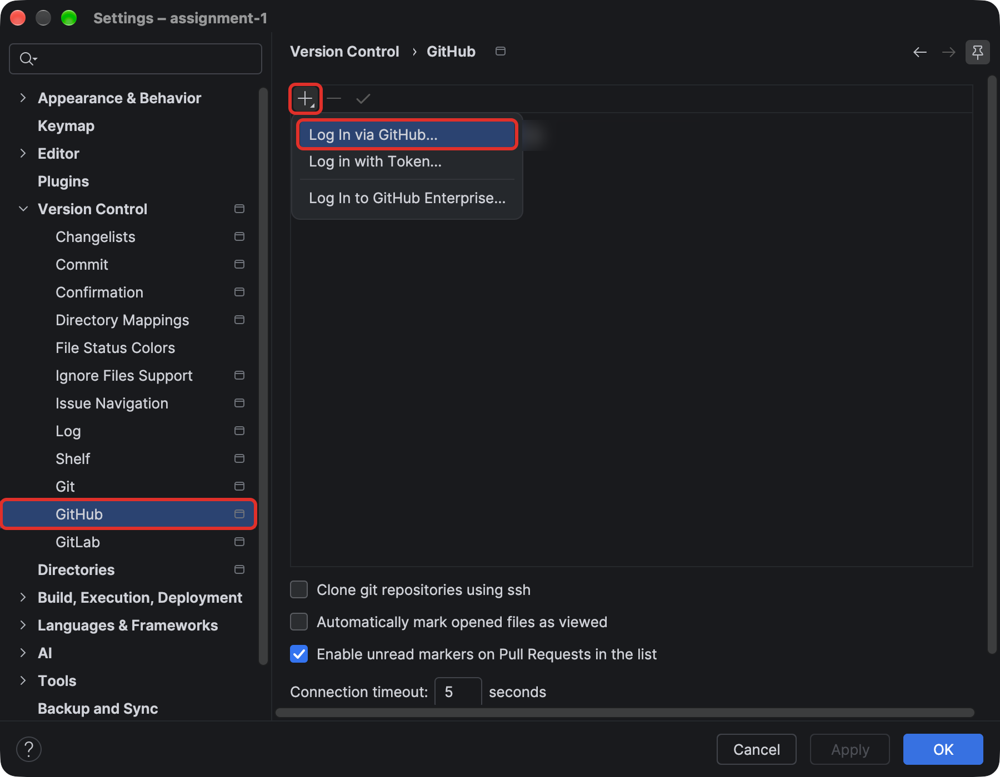
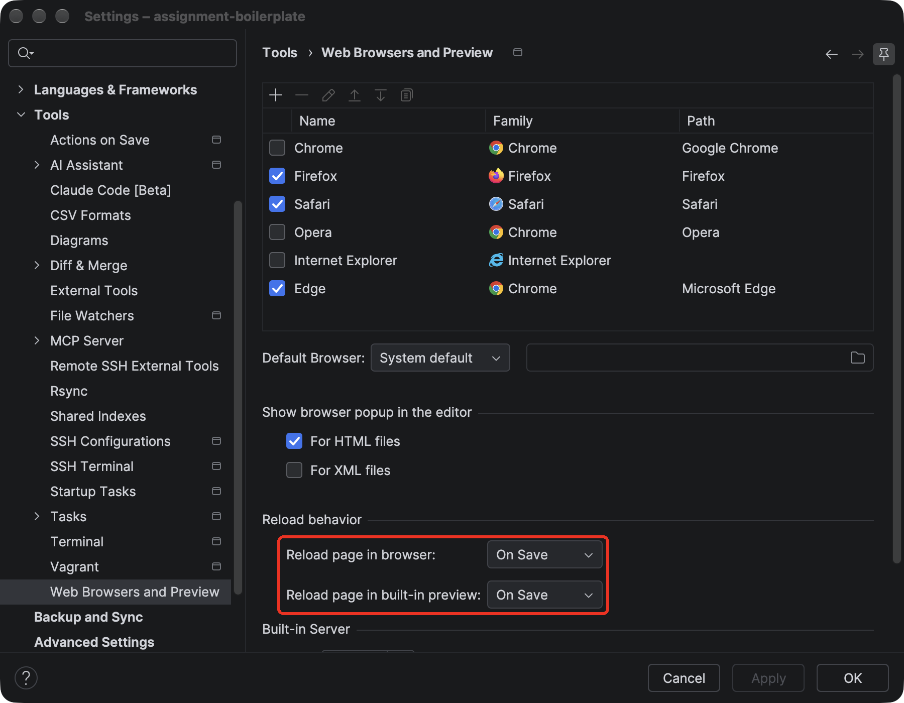
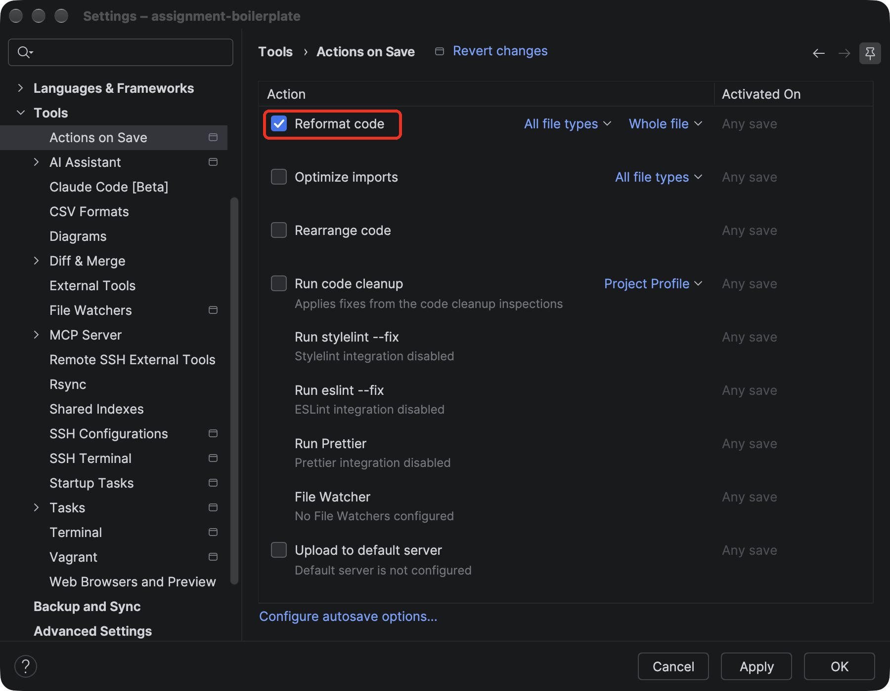
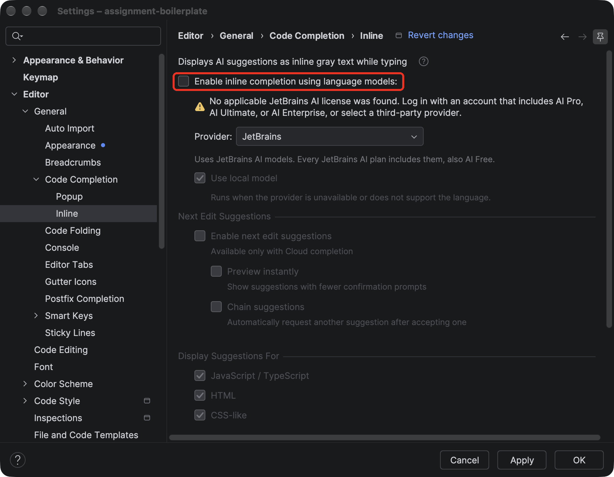

# 🛠️ One-Time WebStorm Setup (macOS)

Do this once, before your first assignment. It takes about 20 minutes. When you're done,
you'll be able to clone, commit, push, and open pull requests without leaving WebStorm.

You'll need:

- A Mac with an internet connection
- Your UC email address (`<your-6+2>@mail.uc.edu`)

## 1. 🐙 Create a GitHub account

Skip this if you already have one.

1. Go to [github.com/signup](https://github.com/signup) and create an account. Choose a
   professional username. Employers will see it.
2. Go to **Settings** → **Emails** and add your UC email address. Verify it from the email
   GitHub sends you.
3. On the same page, uncheck **Block command line pushes that expose my email**. If it's
   checked, WebStorm can't push your commits.

<!-- SCREENSHOT: webstorm-setup-github-emails.png — GitHub Settings → Emails with the UC address listed and "Block command line pushes" unchecked -->

## 2. 💻 Install WebStorm

1. Download WebStorm for macOS from
   [jetbrains.com/webstorm/download](https://www.jetbrains.com/webstorm/download/). Pick
   **Apple Silicon** or **Intel** to match your Mac (Apple menu → **About This Mac** →
   *Chip*).
2. Open the downloaded `.dmg` and drag **WebStorm** into **Applications**.

   
3. Open WebStorm. When it asks about a license, choose **Non-commercial use**. Coursework
   counts as non-commercial.
4. Sign in with (or create) a **JetBrains Account** when asked, and accept the terms.

To check it later, open **Help** → **Register…**. It should say **Non-commercial use**.

> [!NOTE]
> The free non-commercial license sends anonymous usage statistics to JetBrains, and this
> can't be turned off. If you'd rather it didn't, apply for a free
> [student license](https://www.jetbrains.com/community/education/#students) with your UC
> email instead. Approval can take a few days.

## 3. 🧰 Install Git

Git is what tracks your changes. Macs don't come with it, but WebStorm can install it for
you.

1. On the WebStorm welcome screen, click **Clone Repository**.
2. If you see **Git is not installed** at the bottom of the dialog, click
   **Download and Install**. If you don't see it, Git is already installed. Click
   **Cancel** and go on to **Connect WebStorm to GitHub**.

   <!-- SCREENSHOT: webstorm-setup-git-not-installed.png — Clone Repository dialog with the "Git is not installed" banner and Download and Install highlighted -->
3. A macOS window asks to install the **command line developer tools**. Click **Install**,
   then **Agree**. It takes a few minutes.

   <!-- SCREENSHOT: webstorm-setup-xcode-tools.png — macOS "install the command line developer tools" dialog with Install highlighted -->
4. When it finishes, close the Clone Repository dialog with **Cancel**.

You'll tell Git your name and email the first time you commit. See
[Commit your work](PUBLISHING.md#1-commit-your-work-in-webstorm) in the Publishing guide.

## 4. 🔐 Connect WebStorm to GitHub

1. Open **Settings** (<kbd>Cmd</kbd> + <kbd>,</kbd>). On the welcome screen, use
   **Customize** → **All settings…**
2. Go to **Version Control** → **GitHub** and click **+** → **Log In via GitHub…**
3. Your browser opens. Click **Authorize in GitHub**, then **Authorize JetBrains**. Switch
   back to WebStorm. Your account is now listed.

## 5. ⚙️ Adjust a few settings

Stay in **Settings** for these.

1. **Reload the preview when you save.** Go to **Tools** → **Web Browsers and Preview**.
   Set **Reload behavior** to **On Save** for both the built-in preview and the browser.

   

2. **Format your code when you save.** Go to **Tools** → **Actions on Save** and check
   **Reformat code**. This keeps your indentation tidy so nesting is easy to read.

   

3. **Turn off AI code completion.** Go to **Editor** → **General** → **Code Completion** →
   **Inline** and uncheck **Enable inline completion using language models**. This turns
   off Full Line completion, which runs locally. This is required by the
   course [AI policy](../README.md#-ai-policy). It's separate from AI Assistant, and the
   `.noai` file doesn't turn it off.

   

4. Click **OK** to save.

## ✅ You're ready

Follow [Getting Started](GETTING_STARTED.md) for your assignment.

**🛠️ Troubleshooting**

- **WebStorm still says Git isn't installed:** quit and reopen WebStorm after the
  developer tools finish installing. Then go to **Settings** → **Version Control** →
  **Git** and click **Test**. It should show a version number.
- **Push rejected with "push declined due to email privacy restrictions":** finish step
  1.3, then push again.
- **Commits on GitHub show a gray avatar instead of yours:** the email you entered at your
  first commit doesn't match an email on your GitHub account. Add that email to GitHub
  (step 1.2), and new commits will show up correctly.
